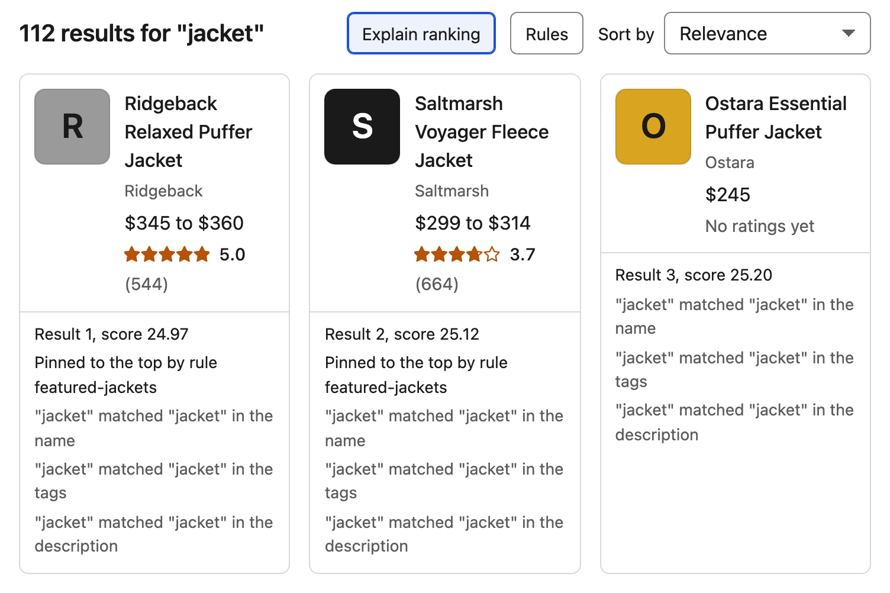

# ShelfLens

**A product search engine that forgives typos and explains why each result ranks where it does.**

ShelfLens is a fictional store, and its search does what a real store's has to. It finds the right
product from a few typed letters, forgives a typo, knows that trainers are sneakers, counts how many
of each brand and color match even after you tick one, lets a merchandiser pin a promotion, and
explains why each result ranked where it did. The storefront is React over a GraphQL API, and on the
demo the whole API runs inside your browser, so a search is answered without a server. Its pages are
built on my [design kit](https://github.com/jasonsdevspace/design-kit), and the engine ships on npm
as `@jasonsdevspace/shelflens`, with no dependencies.

**[Open the demo](https://jasonsdevspace.com/shelflens/)** ·
[Read how it works](https://jasonsdevspace.com/shelflens/about/) ·
[Install the engine from npm](https://www.npmjs.com/package/@jasonsdevspace/shelflens)

<p><a href="https://jasonsdevspace.com/shelflens/?q=jacket&amp;explain=1"><picture>
<source media="(prefers-color-scheme: dark)" srcset=".github/readme/explain-dark.png">

</picture></a></p>

## Why I built it

On an earlier team I worked on a React storefront search backed by a GraphQL search API. Search
looks simple until a shopper types "t shirt" and the Tees outrank the T-Shirts, or a member's price
is served to the next guest from a cache. ShelfLens is a small, complete example of how I work on
that kind of problem. Measure first, write the check that would have caught the mistake, then fix
it. It is built only from public documentation of how such systems behave, with its own names and
its own schema. These are what it promises, and each is held by a test.

- **The list matches what you typed.** An answer to "tra" that arrives after the answer to "trail"
  never replaces it, and a burst of keystrokes costs one request.
- **A price belongs to the shopper asking.** A cache never serves a member's price to the next
  guest.
- **Every result says why it is there.** Each card says which word matched which term in which
  field, and which rule moved it.
- **A search that finds nothing still shows a page.** It offers the phrase without a word, a
  spelling and to clear the filters, then shows the most clicked products.

These and the rest, each with its test, are in the gotchas below.

## A path through the demo

Each step is a link into the live storefront. A first visit offers a tour of the interesting parts,
opened in a corner of the store on a wide screen and offered in a short bar on a phone. The "Tour"
button at the top of the store, beside "Shopping as", walks all nineteen stops with the test behind
each. For the same story without the code, the demo carries [a page on how it
works](https://jasonsdevspace.com/shelflens/about/).

1. **[The store](https://jasonsdevspace.com/shelflens/).** Type "trail runner" quickly. The answer
   to "tra" can arrive after the answer to "trail", and a client that shows whatever came last shows
   the wrong list. This one never does. A burst of keystrokes costs one request, and the suggestion
   list works from the keyboard. Return to the empty box afterward and what this browser searched
   before is offered first, with "Clear" beside it.
2. **[A product a guest cannot see](https://jasonsdevspace.com/shelflens/?product=SL-00008).**
   Choose "Member" under "Shopping as" at the top of the page. It appears, marked as members only,
   and back on the results every price that dropped says it is a member price, with one line saying
   what the switch changed on the page. A cache keyed on the query alone would serve a member's
   answer to the next guest, and a test proves it does. Beneath any product is a rail, the most
   rated in its category until you have viewed a second product, then what you viewed, under a
   heading that says which it is.
3. **[The jacket search with "Explain ranking"
   on](https://jasonsdevspace.com/shelflens/?q=jacket&explain=1).** Two jackets are pinned first by
   a rule, and every card says which word matched which term in which field and what the rule did.
   Sort by price and the pins are set aside, and the page names the rule with a "Sort by relevance"
   button beside it.
4. **[The rules panel on the jacket
   search](https://jasonsdevspace.com/shelflens/?q=jacket&explain=1&rules=1).** Press "Add a rule"
   and name a jacket from the page, and the results beside the panel pin it while you type. "Save
   rule" builds the store again under a new version, and the store's own rules are one press away on
   every page while yours are in effect.
5. **[The jacket search](https://jasonsdevspace.com/shelflens/?q=jacket).** Tick a brand. The other
   brands keep their counts, because each filter's counts leave out that filter's own ticks.
   Everything you did is in the address bar, so copy it or share it, and untick the brand then press
   back to see it return.
6. **[A search for "zzqx jacket"](https://jasonsdevspace.com/shelflens/?q=zzqx%20jacket).** There
   are no results, so the page shows the results of "jacket" instead, offers a spelling when a word
   is two typos off, and falls back to the most clicked products, then the most rated.
7. **[The jacket search with "Explain ranking" on,
   again](https://jasonsdevspace.com/shelflens/?q=jacket&explain=1).** Open a few jackets, then
   reload the page. The ones you opened rise a little, with a line under each card saying how many
   earlier visits opened it, and the pinned ones stay first. The nudge is capped and folds in when a
   visit begins, never mid-page.
8. **[A page that is not the store's](https://jasonsdevspace.com/shelflens/widget/).** Open the
   search box on it. That page styles every list item, button and input, stacks a banner over
   everything, clips the box the widget sits in, and runs a React of its own. The widget keeps its
   look, opens its list over the banner, and sends a search to the store.
9. **[The page for your own products](https://jasonsdevspace.com/shelflens/try/).** Choose a file of
   your own products, or press "Try it with a sample of 200 products". The page guesses which column
   is the name, the price and each filter, and you can correct any guess. Then the same storefront
   searches it, with your own rules, and so does the search box on a made-up store's page. The file
   is read in your browser and never uploaded. The cap of ten thousand products is the largest
   catalog that starts within two seconds on a phone, as [the catalog size
   benchmark](docs/benchmarks/catalog-size.md) records.

The rest of this page is for engineers.

## The gotchas, and the test behind each

The project exists for these. Each one that claims a failure has a test that fails on the naive
version, the tour's stops name them, and the table links each test file.

| Gotcha                                                                                                                                                       | Where it is tested                                                                                                                                                                                                                                   |
| ------------------------------------------------------------------------------------------------------------------------------------------------------------ | ---------------------------------------------------------------------------------------------------------------------------------------------------------------------------------------------------------------------------------------------------- |
| A late answer to an earlier phrase must not win                                                                                                              | [`latest.test.ts`](apps/storefront/src/client/latest.test.ts), [`SearchBox.test.tsx`](apps/storefront/src/search/SearchBox.test.tsx)                                                                                                                 |
| A burst of keystrokes is one request                                                                                                                         | [`SearchBox.test.tsx`](apps/storefront/src/search/SearchBox.test.tsx)                                                                                                                                                                                |
| The suggestion list works from the keyboard: arrow keys, Escape, announcements, an audit                                                                     | [`SearchBox.test.tsx`](apps/storefront/src/search/SearchBox.test.tsx), [`start.spec.ts`](apps/storefront/e2e/start.spec.ts)                                                                                                                          |
| What this browser searched before is offered first, filtered as you type, kept in this browser, cleared by one button, and never a search that found nothing | [`recent.test.ts`](apps/storefront/src/search/recent.test.ts), [`SearchBox.test.tsx`](apps/storefront/src/search/SearchBox.test.tsx)                                                                                                                 |
| A cache keyed on the query alone serves a member's price to a guest                                                                                          | [`cache.test.ts`](packages/api/src/cache.test.ts)                                                                                                                                                                                                    |
| "Café" and "cafe", "T-Shirt" and "tshirt", "shoes" and "shoe" match                                                                                          | [`normalize.test.ts`](packages/engine/src/normalize.test.ts), [`synonyms.test.ts`](packages/engine/src/synonyms.test.ts)                                                                                                                             |
| Ticking one brand never zeroes the others                                                                                                                    | [`facets.test.ts`](packages/engine/src/facets.test.ts)                                                                                                                                                                                               |
| The URL is the page, back undoes a change, and a value it cannot read is ignored                                                                             | [`url.test.ts`](apps/storefront/src/app/url.test.ts), [`useUrlState.test.tsx`](apps/storefront/src/app/useUrlState.test.tsx)                                                                                                                         |
| Paging never shows a product twice or skips one                                                                                                              | [`search.test.ts`](packages/engine/src/search.test.ts)                                                                                                                                                                                               |
| A page past the end is empty with the real total, and a page size past the limit is reduced                                                                  | [`search.test.ts`](packages/engine/src/search.test.ts), [`App.results.test.tsx`](apps/storefront/src/App.results.test.tsx)                                                                                                                           |
| A sort sets aside pins, boosts and buries but keeps hides, and the page says so                                                                              | [`rules.test.ts`](packages/engine/src/rules.test.ts), [`App.merchandising.test.tsx`](apps/storefront/src/App.merchandising.test.tsx)                                                                                                                 |
| Every result says which word matched which term in which field, and which rule moved it                                                                      | [`search.test.ts`](packages/engine/src/search.test.ts), [`synonyms.test.ts`](packages/engine/src/synonyms.test.ts), [`rules.test.ts`](packages/engine/src/rules.test.ts), [`ProductCard.test.tsx`](apps/storefront/src/results/ProductCard.test.tsx) |
| A rule written in the page is previewed before it is saved, and saved as a new store version                                                                 | [`RulesPanel.test.tsx`](apps/storefront/src/results/RulesPanel.test.tsx), [`handle.test.ts`](apps/storefront/src/worker/handle.test.ts)                                                                                                              |
| What shoppers click rises a bounded amount, never past a pin, never out of a bury, and only when a visit begins                                              | [`signals.test.ts`](packages/engine/src/signals.test.ts), [`api.test.ts`](packages/api/src/api.test.ts), [`handle.test.ts`](apps/storefront/src/worker/handle.test.ts), [`ProductCard.test.tsx`](apps/storefront/src/results/ProductCard.test.tsx)   |
| A search that finds nothing still shows a page: the phrase without a word, a spelling, an offer to clear filters, then the most clicked                      | [`recover.test.ts`](packages/engine/src/recover.test.ts), [`api.test.ts`](packages/api/src/api.test.ts), [`App.results.test.tsx`](apps/storefront/src/App.results.test.tsx)                                                                          |
| A product with variants shows a range, in the store's currency and locale                                                                                    | [`money.test.ts`](apps/storefront/src/format/money.test.ts), [`variants.test.ts`](apps/storefront/src/product/variants.test.ts)                                                                                                                      |
| The rail beside a product is never the product itself, and says which of it was viewed together and which is the category's most rated                       | [`recommend.test.ts`](packages/api/src/recommend.test.ts), [`App.product.test.tsx`](apps/storefront/src/App.product.test.tsx)                                                                                                                        |
| Telemetry never blocks the page, counts a twice delivered batch once, carries nothing personal, and stops under Global Privacy Control                       | [`collector.test.ts`](apps/storefront/src/events/collector.test.ts), [`events.test.ts`](packages/api/src/events.test.ts)                                                                                                                             |
| A malformed request is a validation error with a code, never a 500                                                                                           | [`api.test.ts`](packages/api/src/api.test.ts), [`http.test.ts`](packages/api/src/http.test.ts)                                                                                                                                                       |
| The widget keeps its look under a host page's CSS, opens its list over the host's z-index and out of its clipping, and leaves the host's own React counting  | [`widget.test.tsx`](apps/storefront/src/widget/widget.test.tsx), [`widget.spec.ts`](apps/storefront/e2e/widget.spec.ts)                                                                                                                              |

Four product additions carry the rest of the story.

- **The rail** beside a product is built from what this browser viewed, kept in the browser and
  nowhere else. Its heading says plainly when it is showing the category's most rated instead.
- **The nudge** in ranking is built from what this browser clicked, kept in the browser too, which
  is all the intelligence the ranking here has. It is a capped multiplier that folds in when a visit
  begins, so paging never repeats a product, and it never passes a pin.
- **Explain mode** turns the engine's internal state, kept on every hit, into a line under each
  card, the tool a merchandiser needs to answer "why is this product first".
- **Nothing is still a page.** When a search finds nothing, the engine offers a spelling two typos
  away, a shorter phrase with its results and what the same phrase finds without its filters, each
  only if it finds something.

## What was measured

- **The golden queries.** Things a shopper might type, each with what its top results must be, run
  in the test suite. Their first run found that synonyms expanded word by word, so "t shirt"
  credited a Tee twice for one word and ranked it above an actual T-Shirt.
- **The engine.** `npm run bench` indexes a hundred thousand generated products and times the
  requests a storefront sends. Its first run showed about a gigabyte of memory for the index and a
  third of a second for the widest queries. Flat arrays instead of a Map per posting, and result
  objects built only for the page returned, brought that to 84 MB and about a tenth of a second.
  Then the engine stopped doing work a search does not need, counting facets by a code per value,
  ordering only the page's share of the matches, matching a query's narrowest word first and
  explaining only the hits on the page. That brought a two-letter prefix to under a fiftieth of a
  second at the median and a fortieth at the slowest one percent, and a three-word query to under a
  millisecond. [The engine benchmark](docs/benchmarks/results.md) is kept with the machine it ran
  on.
- **The popover.** Results must be visible within 150 ms of the last keystroke. The search box waits
  100 ms for the typing to pause, and the slowest suggestion on the demo catalog takes well under
  the 50 ms left, as [the popover benchmark](docs/benchmarks/popover.md) records.
- **The cold first visit.** With nothing cached, the page is ready to search in about a fifth of a
  second served locally, with the worker spending 39 ms downloading the catalog and the rules and 43
  ms building the store. Compressed as a server sends them, the catalog is 332 KB, the page's
  scripts 99 KB and the worker 76 KB, as [the cold visit benchmark](docs/benchmarks/cold-visit.md)
  records.

**Budgets and audits, in CI.** Compressed, each of these is held to a budget, or CI fails.

| What is held                         | Held to, compressed |
| ------------------------------------ | ------------------- |
| The catalog                          | 400 KB              |
| The API, bundled for a browser       | 90 KB               |
| The page                             | 104 KB              |
| The page for a visitor's own catalog | 115 KB              |
| The widget                           | 85 KB               |
| The service worker                   | 85 KB               |

The API's budget is held by a test that bundles it for a browser, the rest by `npm run budget` over
the build. Nothing from GraphQL goes in a page or the widget, and no test fixture goes in anything
shipped. The storefront runs in a real browser on a desktop and a phone profile with an
accessibility audit of every page it reaches, and every control's edge, focus ring and caret are
held to the design in both themes. Lighthouse must score a hundred for accessibility, and at least
ninety for performance with the largest paint inside two and a half seconds and a layout shift of no
more than a tenth on a first visit, on the home page, a results page in explain mode, a category, a
product, the explainer, the widget's host page, and the page for a visitor's own catalog, both empty
and with a file loaded, and the widget on a store's page over that file.

## How the parts fit

Follow one keystroke.

1. The search box waits for typing to pause, then asks for suggestions through the same query hook
   as every other question the page asks.
2. The page's GraphQL client looks in its memory under the one cache key, and otherwise sends the
   operation's persisted name, the hash of its text, in a `GET` with the variables and the store
   version it last saw.
3. On the demo the service worker answers it. One `routeOf` says which of its paths the request
   names, and an answer kept in the Cache API under that URL is served while it is fresh.
4. Otherwise the store host's API runs the query, read once and kept, through the resolvers.
5. The resolvers turn it into the engine's request through the search package, which knows the
   catalog's fields, facets, synonyms and customer groups.
6. The engine matches the words, ranks them, applies the merchandising rules and the bounded nudge
   from what shoppers chose, counts the facets and returns the page.
7. The answer comes back with the store version in a header, the client keeps it, and the box shows
   it only if it is still the newest request.

The Node server answers the same request through the same store host over HTTP.

## What is here

[](https://www.npmjs.com/package/@jasonsdevspace/shelflens)

The libraries are in `packages/`, and what runs, the demo and the server, is in `apps/`.

- [`@jasonsdevspace/shelflens`](packages/engine) is the search engine, [on
  npm](https://www.npmjs.com/package/@jasonsdevspace/shelflens), with no dependencies. It holds one
  normalization for catalog and query, exact-then-fuzzy matching, phrase synonyms, facets,
  merchandising rules, a bounded nudge from what shoppers chose, a recovery for nothing, and an
  explanation on every hit.
- [`@shelflens/catalog`](packages/catalog) is a deterministic generator for the store's product
  catalog, so every test and benchmark runs against the same data.
- [`@shelflens/search`](packages/search) maps the catalog onto the engine, with the field weights,
  facets, synonyms, customer groups, the golden queries and the benchmark.
- [`@shelflens/api`](packages/api) is the GraphQL API the storefront is written against, with the
  schema, its generated types, the resolvers, the one cache key, the shape over HTTP, and the
  receiver for the shopper's events. It holds nothing from Node, so it runs in a service worker.
- [`@shelflens/server`](apps/server) is the same API over HTTP, for local runs and anything that
  cannot host a service worker.
- [`@shelflens/storefront`](apps/storefront) is the demo, with a typed GraphQL client of its own,
  the popover, the results page, explain mode, the no-results page, the product page with its rail,
  the tour, a page on how it works in plain words, the collector that sends what the shopper did,
  and the service worker that is the API in the browser and keeps those events.

## Decisions

Each choice with a real alternative is a record in [docs/decisions](docs/decisions), with the
option rejected, what the choice costs, and the test or measurement behind it. Most were written
when the choice was made, and records 16, 17 and 19 after the work they describe. Every record
is read again against the code before each release, and amended where the code has moved on.

1. [An engine of our own, rather than a library](docs/decisions/0001-an-engine-of-our-own.md)
2. [Flat arrays for the index](docs/decisions/0002-flat-arrays-for-the-index.md)
3. [Synonyms rewrite phrases, scored per typed word](docs/decisions/0003-synonyms-rewrite-phrases.md)
4. [Facets count past their own filter](docs/decisions/0004-facets-count-past-their-own-filter.md)
5. [The shape of the API](docs/decisions/0005-the-shape-of-the-api.md)
6. [The API runs in the browser, and in Node when asked](docs/decisions/0006-the-api-runs-in-the-browser.md)
7. [A GraphQL client of our own, rather than Apollo or urql](docs/decisions/0007-a-client-of-our-own.md)
8. [One cache key, defined once, for three layers](docs/decisions/0008-one-cache-key.md)
9. [Events land beside the API, and stay in the browser](docs/decisions/0009-events-stay-in-the-browser.md)
10. [A rule is previewed by the engine, and saved as a new store version](docs/decisions/0010-rules-live-in-the-browser.md)
11. [Recent searches are page state, kept in local storage](docs/decisions/0011-recent-searches-are-page-state.md)
12. [The widget keeps its own tree, and its popover takes the top layer](docs/decisions/0012-the-widget-keeps-its-own-tree.md)
13. [A visitor's catalog stays in the browser, in a store of its own](docs/decisions/0013-a-visitors-catalog-stays-in-the-browser.md)
14. [The engine is proven on the Node it declares, as a user installs it](docs/decisions/0014-the-engine-is-proven-on-the-node-it-declares.md)
15. [One store host for every transport](docs/decisions/0015-one-store-host-for-every-transport.md)
16. [The first screen is in the page, drawn by the components the script uses](docs/decisions/0016-the-first-screen-is-in-the-page.md)
17. [A sort sets aside what rules do to the order, and the page says so](docs/decisions/0017-a-sort-sets-aside-what-rules-do-to-the-order.md)
18. [Visits are counted by path, with Plausible, and not under Global Privacy Control](docs/decisions/0018-visits-are-counted-by-path.md)
19. [The pages are drawn from the design kit, and the store keeps what is its own](docs/decisions/0019-the-pages-are-drawn-from-the-design-kit.md)
20. [Dependencies install without their scripts](docs/decisions/0020-dependencies-install-without-their-scripts.md)

## Dev setup

How to contribute is in [CONTRIBUTING.md](.github/CONTRIBUTING.md), and what the demo holds
itself to for accessibility, and how to report a barrier, is in
[ACCESSIBILITY.md](docs/ACCESSIBILITY.md).

You need [Node.js 24](https://nodejs.org/) and Git. The version is in `.nvmrc`, so `nvm use` picks it.

```bash
git clone https://github.com/jasonsdevspace/shelflens.git
cd shelflens
npm ci
npm run verify
```

`npm run verify` runs the checks CI runs before it builds anything: type checking, linting,
formatting, a prose check, a check that everything names the Node version in `.nvmrc`, a check that
nothing is exported or depended on that nothing uses, and the tests, golden queries included. CI also
checks that the generated types match the schema and holds the build to its size budgets. Use
`npm test` for watch mode while you work. CI also runs the storefront in a real browser with
`npm run e2e` and audits it with `npm run lighthouse`, which need Chromium once:
`npx playwright install chromium`.

<details>
<summary>What CI runs, and what it reports</summary>

In CI the browser tests, desktop and phone together, are split into two even halves that run side by
side. Every job runs on a named Ubuntu image within a time limit, and every install skips the
install scripts of what it installs, as [record
20](docs/decisions/0020-dependencies-install-without-their-scripts.md) says. A test holds the
workflows to both. Each check writes what it found to its run's page on GitHub: the browser tests'
totals and any test that failed, every page's Lighthouse scores against the gates, each part's size
against its budget with a chart of how much of each budget it uses, the engine package's size file
by file, where a failed screenshot comparison keeps its diffs, the live link a deploy made, and what
a release staged and published. `scripts/summary.mjs` writes them, and its tests hold what each
says.

</details>

To work on the storefront:

```bash
npm run dev
```

That serves the page with hot reloading, and answers the API from the dev server through the
same resolvers and the same rules file the service worker runs in production. `npm run storefront`
builds what the demo deploys: the page, the catalog, the rules and the worker, which `npx vite
preview` in `apps/storefront` then serves. Every merge to main that passes CI deploys it.

More commands worth knowing:

- `npm run catalog -- --products 50 --out data/catalog.json` writes a catalog to look at.
- `npm run bench`, `npm run bench:popover`, `npm run bench:cold` and `npm run bench:sizes` run the
  benchmarks and write their results to `docs/benchmarks/`.
- `npm run api` serves the API on port 8080, which runs only the storefront's own operations unless
  it is told to take a query sent by hand:

    ```bash
    FULL_QUERIES=true npm run api
    curl localhost:8080/graphql --header 'content-type: application/json' \
      --header 'shelflens-customer-group: member' \
      --data '{ "query": "{ search(input: { phrase: \"boot\" }) { total items { product { name } } } }" }'
    ```

<details>
<summary>How the engine and the storefront are released</summary>

To release the engine, bump the version in `packages/engine/package.json`, run `npm install
--package-lock-only` so the lock file carries it, add the entry to `packages/engine/CHANGELOG.md`,
merge that, then push a tag named for the version, such as `engine-v0.2.0`. The release workflow
confirms the tag, the version and the changelog agree and that the commit is on main, runs every
check CI runs, stages the version on npm with provenance through npm's trusted publishing, and
creates the GitHub release with the changelog entry as its notes. The version goes live when it is
promoted on the package page on npmjs.com, so a release needs a tag from main, a green run and one
click, and nothing that happens in CI alone can change what `latest` points at. A version with a
hyphen, such as `0.2.0-rc.1`, is staged under the `next` tag and marked as a prerelease. The job
that stages holds the publish token, so it installs nothing but a pinned npm, from a tarball checked
against the checksum npm's registry gives for that version, and fetches nothing else. It stages
nothing for a version npm has already published, and passes. It stops on a version that is staged
and not yet promoted, since npm's lookup does not show a staged version and the workflow cannot tell
one staged by an earlier run from one staged from other code, so a run whose later step failed is
repeated with "Re-run failed jobs", which keeps the staging and runs only what failed.

The storefront is released the same way with a tag such as `storefront-v1.2.0`, against
`apps/storefront/package.json` and `apps/storefront/CHANGELOG.md`. It is deployed from main already,
so its release is a page on GitHub naming the version and what changed, and nothing goes to npm.
With nothing to promote, it needs only the tag from main and a green run, and the engine's release
stays the one marked latest.

</details>

The schema is `packages/api/schema.graphql` and the storefront's operations are in
`apps/storefront/src/operations/`. Changing either means running `npm run codegen` and
committing the generated types and the persisted operations, which CI checks. The demo's
merchandising is `apps/storefront/public/rules.json`, validated when the store is built.

## Project layout

<details>
<summary>What each folder holds</summary>

- `packages/engine/` holds the search engine, published as `@jasonsdevspace/shelflens`. Its `src/`
  holds normalize, index-builder, match, edits, synonyms, filters, facets, rules, order and search.
- `packages/catalog/` holds the generator, its vocabulary and its types.
- `packages/search/` holds the documents, the store config, customer groups, golden queries and the
  benchmark.
- `packages/api/` holds the schema, its generated types, the resolvers, the store host, the routes,
  the cache key, the shape over HTTP, and the events and rules receivers. Its `scripts/` holds the
  steps codegen runs after it, which inline the schema and name each operation, and the test of
  the operation naming step.
- `apps/server/` holds the API behind HTTP, with a rate limit and a request id.
- `apps/storefront/` holds the demo page and the widget's hosts, with the design kit's theme script.
    - `about/` holds the page on how it works, built beside the demo.
    - `public/` holds the rules file, and the catalog the build writes beside it.
    - `src/` holds `tokens.css`, the store's values over the design kit's, and `styles.css`, and
      these folders:
        - `app/` holds the URL as state, categories, the store context, the first screen, focus and
          the live status.
        - `client/` holds the GraphQL client, its memory, the latest-request helper, and the rules
          and catalog clients.
        - `search/` holds the popover.
        - `results/` holds facets, sort, pages, explain mode, nothing and the rules panel.
        - `product/` holds the product page.
        - `format/` holds money and counts in the store's locale.
        - `events/` holds the collector.
        - `tour/` holds the tour.
        - `try/` holds a visitor's own catalog.
        - `widget/` holds the search box for other pages.
        - `worker/` holds the API as a service worker, and the events, rules and catalog it keeps.
        - `dev/` holds the API inside the dev server, the first screen and each built page's policy.
        - `bench/` holds the measurements and the audit.
        - `operations/` and `generated/` hold the storefront's operations and their generated types.
- `docs/` holds the accessibility statement in `ACCESSIBILITY.md`, the recorded measurements in
  `benchmarks/` and the decision records in `decisions/`.
- `scripts/` holds the Node check, the run summaries, the screenshot collector, the release notes
  script, the shared repository and JSON helpers in `repository.mjs` and `json.ts`, and the tests
  that read the whole repository.
- `.github/` holds the contributing guide, the security policy, the templates, the workflows, the
  Dependabot config in `dependabot.yml` and the README's pictures in `readme/`.

</details>

## Background

The behavior modeled here, search as you type with a two-character minimum, exact search before a
fuzzy pass that allows one edit per word, synonyms, facet buckets of several kinds, merchandising
rules whose pins, boosts and buries apply only under relevance sort, and results that vary by
customer group, follows what a widely used commerce platform documents publicly for its search
service. The implementation, the names and the schema are this project's own.

## License

MIT. See [LICENSE](LICENSE).
